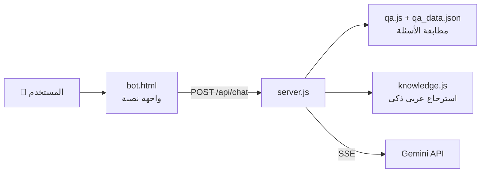

<div align="center">

# 🤖 Modern Gas Bot

### مساعد شركة الحديثة للغاز الطبيعي — بالعامية المصرية — نص فقط (بدون صوت)

[](https://nodejs.org)
[](https://ai.google.dev)

</div>

---

## ✨ المميزات

| | |
|:--|:--|
| 💬 **نص فقط** | مفيش مايك، مفيش نطق، مفيش أي طلبات TTS — البوت بيقرأ ويكتب بس |
| 🧠 **فهم بالمعنى** | بيفهم إعادة الصياغة والمرادفات والغلط الإملائي البسيط |
| 📚 **داتا أسئلة جاهزة** | `qa_data.json` — إجابة مؤكدة لأي سؤال شبيه، حتى لو اتكتب بصياغة مختلفة |
| 🔍 **RAG من المستندات** | استرجاع تلقائي من `knowledge_docs.json` + `knowledge.js` |
| ⚡ **بث فوري** | الرد بيظهر حرف حرف (SSE) |
| 🪶 **بدون فريمورك** | Node http عادي — لا Express ولا قاعدة بيانات |

## 🏗️ المعمارية



**دورة الرد:** سؤال → مطابقة داتا الأسئلة (لو فيه إجابة مؤكدة نرجّعها فوراً) → استرجاع المستندات → برومبت لـ Gemini → بث النص.

## 🚀 التشغيل

```bash
# 1) المفتاح (ملف محلي — مش على Git)
echo "YOUR_KEY_HERE" > gemini_key.txt

# 2) شغّل
node server.js          # أو: start-bot.bat
```

ثم افتح 👉 **http://localhost:3456**

## 🧠 إضافة داتا أسئلة

الملف: `qa_data.json`

```json
[
  {
    "q": [
      "إزاي أتعاقد على الغاز؟",
      "عايز اشترك غاز لبيتك",
      "طريقة تسجيل مشترك جديد"
    ],
    "a": "التعاقد بيتم في أقرب مركز خدمة عملاء بالمستندات المطلوبة..."
  }
]
```

- كل سؤال في `q` هو صيغة مختلفة لنفس المعنى.
- المطابقة بتشمل مرادفات، تصريف، ترتيب كلمات مختلف، وغلط إملائي بسيط.
- التعديل على الملف بيتحمّل تلقائياً (أو `POST /api/qa/reload`).
- لو مفيش مطابقة قوية، السؤال بيروح لـ Gemini مع نفس الداتا مضافة للبرومبت.

## 📚 تحديث المعرفة العامة

- `knowledge.js` — الأسئلة/الأجوبة القصيرة (`KG` + `CS`)
- `knowledge_docs.json` — نصوص المستندات الطويلة

## ⚙️ الإعداد

| متغير بيئة | الافتراضي | الوصف |
|:--|:--|:--|
| `GEMINI_KEY` | — | مفتاح Gemini (أو ضعه في `gemini_key.txt`) |

## 📁 هيكل المشروع

```
├── bot.html              # الواجهة النصية
├── server.js             # سيرفر HTTP + مطابقة الأسئلة + Gemini
├── qa.js                 # محرك مطابقة الأسئلة بالمعنى
├── qa_data.json          # داتا الأسئلة والأجوبة 👈 عدّل هنا
├── knowledge.js          # قاعدة المعرفة + الاسترجاع العربي
├── knowledge_docs.json   # نصوص المستندات
├── start-bot.bat         # تشغيل بنقرة واحدة (ويندوز)
└── gemini_key.txt        # 🔑 محلي فقط — خارج Git
```

## 🔐 أمان

- المفاتيح خارج الكود (متغيّر بيئة / ملف محجوب).
- `chat_log.jsonl` محجوب عن Git — سجلات المحادثات تبقى محلياً.

---

<div align="center">
<sub>صُنع بـ ❤️ لخدمة عملاء مودرن جاز</sub>
</div>
