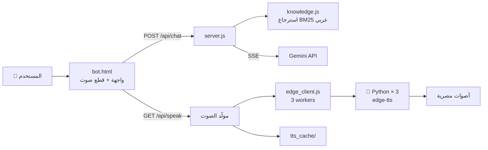

<div align="center">

# 🤖 Modern Gas Bot

### مساعد شركة الحديثة للغاز الطبيعي — بالعامية المصرية وبصوت طبيعي

[](https://nodejs.org)
[](https://python.org)
[](https://ai.google.dev)
[](https://github.com/rany2/edge-tts)
[](#)

</div>

---

## ✨ المميزات

| | |
|:--|:--|
| 🇪🇬 **صوت مصري طبيعي** | أصوات Edge Neural (`ar-EG-Shakir` / `Salma`) — من غير Google الآلي |
| ⚡ **أول كلمة بسرعة** | أول جملة بتتولّد وتتشغّل والباقي لسه بيولّد (بالتوازي) |
| 🔗 **ترتيب متواصل** | قطع الصوت بتتولّد بوابة ≤2 مع بعض فتظلّل الكلام متسلسل من غير وقفات |
| 🧠 **ردود من مستندات الشركة** | استرجاع تلقائي (RAG) من قاعدة المعرفة + Gemini |
| 📡 **بث فوري** | الرد بيظهر حرف حرف (SSE) والصوت يبدأ قبل ما الرد يخلص |
| 💾 **كاش صوت** | نفس الجملة مرة تانية = استجابة فورية (SHA-1 cache) |
| 🔄 **احتياطيات متعددة** | Edge → Azure (اختياري) → Gemini TTS → متصفح — مفيش مسار ميت |
| 🪶 **بدون فريمورك** | Node http عادي + عامل بايثون خفيف — لا Express ولا قاعدة بيانات |

## 🏗️ المعمارية



**دورة الرد:** سؤال → استرجاع المستندات المرتبطة → برومبت لـ Gemini → بث النص → تقطيعه لقطع صوتية متوازية → تشغيل مرتّب بالترتيب.

## 🚀 التشغيل

```bash
# 1) المتطلبات
pip install edge-tts

# 2) مفتاح Gemini (ملف محلي — مش على Git)
echo "YOUR_KEY_HERE" > gemini_key.txt

# 3) شغّل
node server.js          # أو: start-bot.bat
```

ثم افتح 👉 **http://localhost:3456**

> الملف الأساسي `bot.html` — لو مستضيف مع جيت هوب Pages أو cPanel، ارفع المجلد كله واكتب مفتاحك في `gemini_key.txt`.

## ⚙️ الإعداد

| متغير بيئة | الافتراضي | الوصف |
|:--|:--:|:--|
| `GEMINI_KEY` | — | مفتاح Gemini (أو ضعه في `gemini_key.txt`) |
| `EDGE_WORKERS` | `3` | عدد ووركرز توليد الصوت المتوازية |
| `EDGE_TIMEOUT_MS` | `20000` | مهلة المقطع الواحد قبل إعادة المحاولة |
| `EDGE_GRACE_MS` | `20000` | مهلة الصوت الطويل على المسار الاحتياطي |

**الأصوات:** `Charon` → رجالي · `Aoede`/`Kore` → نسائي — تتحدد من شريط الصوت في الواجهة.

## 📚 تحديث المعرفة

البوت مش مدرّب — بيقرأ من ملفاتك، وتحديثها فوري:

1. `knowledge.js` — الأسئلة/الأجوبة القصيرة (`KG` + `CS`)
2. `knowledge_docs.json` — نص المستندات الطويلة (التقارير السنوية… إلخ)

أي إضافة هنا تظهر في ردود البوت في نفس اللحظة — **بدون أي تدريب**.

## 📁 هيكل المشروع

```
├── bot.html              # الواجهة + منطق الصوت (تقطيع، بوابة، ترتيب)
├── server.js             # سيرفر HTTP + Gemini + توليد الصوت
├── knowledge.js          # قاعدة المعرفة + الاسترجاع (BM25 عربي)
├── knowledge_docs.json   # نصوص المستندات
├── edge_client.js        # بركة ووركرز الصوت (JSON على stdin/stdout)
├── edge_tts_worker.py    # عامل Edge TTS دائم
├── start-bot.bat         # تشغيل بنقرة واحدة (ويندوز)
└── gemini_key.txt        # 🔑 محلي فقط — خارج Git
```

## 🔐 أمان

- ✅ المفاتيح خارج الكود (متغيّرات بيئة / ملفات محجوبة)
- ✅ Push Protection مفعّل — Git يرفض رفع أي سر
- ⚠️ `chat_log.jsonl` محجوب عن Git — سجلات المحادثات تبقى محليًا

---

<div align="center">
<sub>صُنع بـ ❤️ لخدمة عملاء مودرن جاز</sub>
</div>
